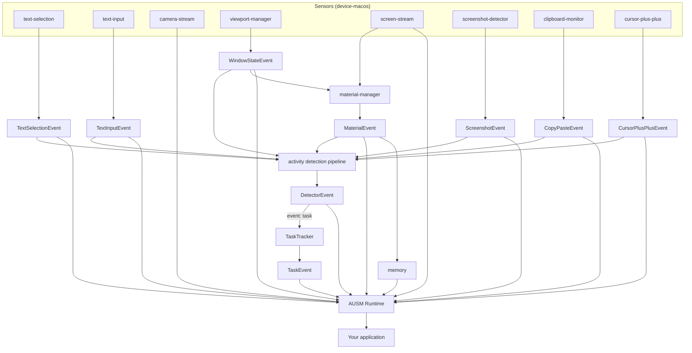

# ausm

**activity understanding and scaffolding medium.** it turns what you do on your mac into live, typed context for apps and agents.

[docs](https://foundation-interface.github.io/ausm/) · [reference](docs/reference.md) · [agent skill](skills/ausm/SKILL.md) · mit · macos 13+

most software only knows what happens inside itself. an assistant that wants to help has to wait for you to paste the context in. ausm watches the whole mac, on your machine, and tells your code what you're doing as it happens:



it isn't a screen recorder. you get structured events you can react to, not hours of video to search.

## why not just write it yourself

reading the clipboard takes three lines. getting reliable context out of macos doesn't:

- **screenshots.** on macos 26, `screencapture` exits before you've even dragged a rect. ausm follows the gesture and captures the real selection
- **browsers and electron apps** hide their text from accessibility until you set a private flag. ausm sets it, so selection and typing work in chrome and electron apps too
- **a window isn't a thing.** one browser window is twenty tabs. ausm gives each tab, file or channel a stable id, dedupes its frames by perceptual hash and runs ocr on them
- **privacy.** password fields are skipped, apps can be blacklisted, and memory is one sqlite file on your disk
- **it keeps running.** helpers ship as prebuilt universal binaries, report missing permissions instead of going silent, and recover when macos disables an event tap

we built ausm for our own research prototypes and kept fixing the edge cases, so you don't have to.

## use

```sh
npm install ausm
```

```ts
import { createRuntime } from 'ausm/runtime'

const ausm = createRuntime({
  enableScreenStreaming: true,
  materialManager: { enabled: true, dbPath: 'ausm.db' },
})
await ausm.initialize()

ausm.onTextSelectionEvent(e => console.log('selected', e))
ausm.onMaterialEvent(e => console.log('looking at', e))
ausm.onTaskEvent(e => console.log('doing', e))  // needs a model, e.g. CEREBRAS_API_KEY
```

teach it something new with a markdown file. drop a folder with a `DETECTOR.md` into one of your `detectors.extraDirs`:

```md
---
name: stuck
description: notices when the user is stuck on an error
event: stuck
---
fire when the user keeps switching between the same error and the docs
for a few minutes without editing any code.
```

then listen with `ausm.onDetectorEvent`.

building a native mac app? the screenshot, cursor, clipboard, window and text input sensors also come as swift packages, with no node needed:

```swift
.package(url: "https://github.com/foundation-interface/ausm.git", from: "0.1.0")
// products: ScreenshotMonitorKit, CursorMonitorKit, ClipboardMonitorKit, WindowMonitorKit, TextInputMonitorKit
```

your app needs **accessibility**, plus **screen recording** for screenshots and frames. everything stays on your mac. if you add a model provider (cerebras, vertex or any openai-compatible endpoint), only the focused window's frame and a summary of recent events are sent.

## more

- [docs](https://foundation-interface.github.io/ausm/): sensors, materials, memory, tasks and models, with live diagrams
- [reference](docs/reference.md): every event, option, detector field and build step
- coding agents: `npx skills add foundation-interface/ausm`

built at the foundation interface lab, uc san diego, by rima cao and haijun xia. [fairy cursor](https://github.com/Rrrima/fairy-cursor) runs on it.
