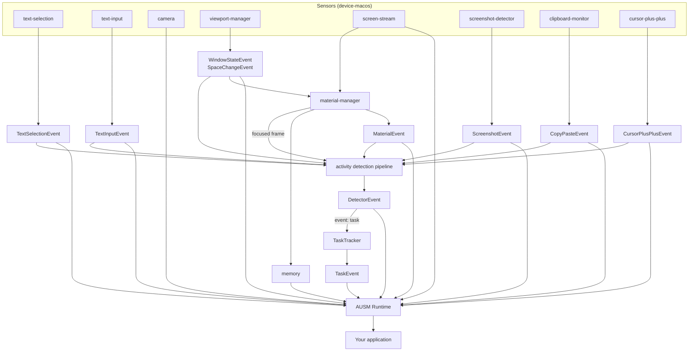
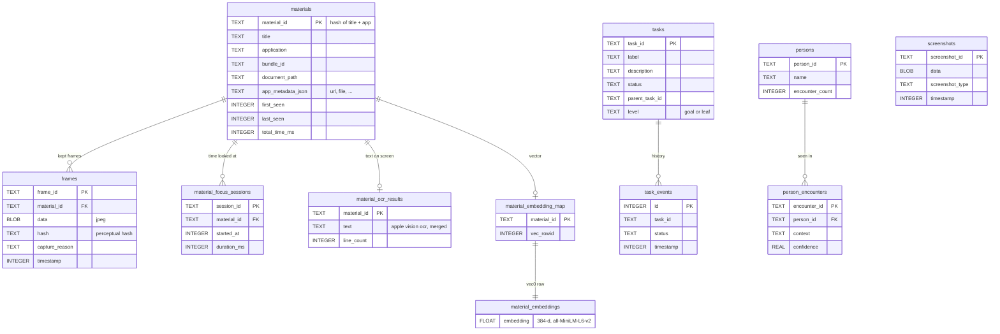
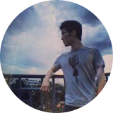
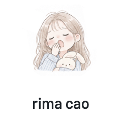
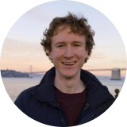
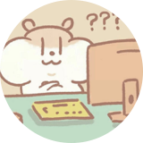

# ausm

**activity understanding and scaffolding medium.** ausm turns what you do on your mac into live, typed context for apps and agents: what you select, type, copy and capture, which tab or file you're looking at, and what task you're working on.

[docs](https://foundation-interface.github.io/ausm/) · [reference](docs/reference.md) · [agent skill](skills/ausm/SKILL.md) · mit · macos 13+

most software only knows what happens inside itself, so an assistant has to wait for you to paste the context in. ausm watches the whole mac, on your machine, and hands your code structured events as they happen. it isn't a screen recorder: you get events you can react to, not hours of video to search.



three layers, each optional on top of the one before: **sensors** report what happens, **materials** remember what you looked at, and **tasks** name what you're doing.

## use

```sh
npm install ausm
```

```ts
import { createRuntime } from 'ausm/runtime'

const ausm = createRuntime({
  enableScreenStreaming: true,
  materialManager: { enabled: true, dbPath: 'ausm.db' },
  detectorPipeline: { provider: 'cerebras' },   // see "models" below
})

ausm.onTextSelectionEvent(e => console.log('selected', e.selectedText))
ausm.onMaterialEvent(e => console.log('looking at', e.materialEventType))
ausm.onTaskEvent(e => console.log('doing', e.taskLabel))
await ausm.initialize()
```

building a native mac app? five sensors also come as swift packages that compile into your app, with no node at all:

```swift
.package(url: "https://github.com/foundation-interface/ausm.git", from: "0.1.0")
// products: ScreenshotMonitorKit, CursorMonitorKit, ClipboardMonitorKit, WindowMonitorKit, TextInputMonitorKit
```

your app (or, in development, your terminal) needs **accessibility**, plus **screen recording** for screenshots and frames.

using a coding agent? `npx skills add foundation-interface/ausm` teaches it the api.

## sensors

each sensor is a small native helper under [`device-macos/`](device-macos) that reads one kind of activity from macos and reports it as a typed event. the runtime starts them as child processes, restarts them if they crash, and logs when a permission is missing.

| sensor | what it notices | event | permission | default |
|---|---|---|---|---|
| text-selection | text you select, in any app | `TextSelectionEvent` | accessibility | on |
| viewport-manager | windows appearing, focusing, retitling, moving; space changes | `WindowStateEvent`, `SpaceChangeEvent` | accessibility, screen recording for titles | on |
| screenshot-detector | system screenshots (⌘⇧3/4/5), with the image | `ScreenshotEvent` | accessibility, screen recording | on |
| clipboard-monitor | copy and paste, with content type | `CopyPasteEvent` | none | on |
| text-input | what you type into text fields (never password fields) | `TextInputEvent` | accessibility | off |
| cursor-plus-plus | clicks, scrolls, holds, drags, and the ui element under the cursor | `CursorPlusPlusEvent` | accessibility | off |
| screen-stream | screencapturekit frames in shared memory, for materials | (feeds materials) | screen recording | off |
| camera | webcam frames, polled with `captureLatestCameraFrame()` | (polled) | camera | off |

the fiddly parts are handled for you:

- **screenshots.** on macos 26, `screencapture` exits before you've even dragged a rect. ausm follows the gesture and captures the real selection
- **browsers and electron apps** hide their text from accessibility until you set a private flag. ausm sets it, so selection and typing work in chrome and electron apps too
- **privacy.** password fields and concealed clipboard entries are skipped, and apps can be blacklisted
- **it keeps running.** helpers ship prebuilt, report missing permissions instead of going silent, and recover when macos disables an event tap

## materials

a **material** is one thing you look at: a browser tab, a file in an editor, a slack channel. one browser window can hold twenty materials, so ausm doesn't track windows. it tracks titles within an app: the material id is a hash of the window title and the app, so the same tab keeps its id across focus changes and restarts.

with `enableScreenStreaming` and `materialManager.enabled`, the material-manager crops the focused window out of the screen stream when it appears, gains focus, changes title, loses focus, and every 2 s. it keeps a frame only when it looks different from the last one (a tiled perceptual hash, distance ≥ 8), up to 200 per material. apps add their own fields: browsers report the url and domain, editors the file path.

everything lands in one sqlite file at `materialManager.dbPath` (default `:memory:`, gone on quit), with [sqlite-vec](https://github.com/asg017/sqlite-vec) for semantic search:



- **frames** are the deduplicated jpegs of each material. `getMaterialLatestFrame(id)` and `getMaterialFrames(id)` read them
- **focus sessions** add up how long you looked at each material. `getMaterialWeights(days)` ranks materials by that time, with older time decaying on a 7-day half-life
- **ocr** (`memory: { ocrEnabled: true }`) reads the text in a material's frames with apple vision when you leave it, merges new lines into one document and emits `MATERIAL_CONTENT_UPDATED`. read it with `getMaterialContent(id)`
- **embeddings** of that text are computed on your mac (the model downloads from hugging face once) and power semantic search
- **tasks** and **persons** tables are in the schema, but the runtime doesn't write to them yet: `TaskEvent`s reach your callbacks only, so store them yourself if you need a history

`freezeMemory()` pauses all writes. the file sits in a folder only you can read, and deleting it forgets everything.

## tasks

the detector pipeline looks at the focused window's latest frame and your recent events, and asks a vision model which of your **detectors** fired. a detector is a plain-language rule in a markdown file. ausm ships one, `rapid-task`, which names what you're doing; the `TaskTracker` turns those names into `TaskEvent`s with stable ids, so "writing typescript: runtime.ts" stays one task while you work on it.

### declare a detector

make a folder with a `DETECTOR.md` and point `detectors.extraDirs` at its parent:

```md
---
name: stuck
description: notices when the user is stuck on an error
event: stuck
interval: 30000
cooldown: 60000
sources: [screen, events]
events: [window-state, text-input, copy-paste]
---
fire when the user keeps switching between the same error and the docs
for a few minutes without editing any code. summarise the error in under 12 words.
```

```ts
const ausm = createRuntime({ detectors: { extraDirs: ['./detectors'] } })
ausm.onDetectorEvent(e => { if (e.eventType === 'stuck') offerHelp(e.summary) })
```

| field | meaning |
|---|---|
| `name`, `description`, `event` | required. `event` comes back as `eventType`; `task` is reserved for the task tracker |
| `interval` | minimum ms between checks (default = `cooldown`) |
| `cooldown` | ms a detector stays quiet after it fires (default 10000) |
| `debounce` | at most this many ms from new activity to a check (default `interval / 2`) |
| `sources` | what the model sees: `screen` (the focused window's frame), `events`, or both |
| `events` | which kinds enter the prompt: `material window-state text-input text-selection copy-paste cursor screenshot` |
| `isolated` | `true` gives the detector its own model call; otherwise detectors with the same sources and events share one |
| `enabled` | `false` turns it off; `detectors.entries.<name>.enabled: false` does the same from config |

the body below the frontmatter is what the model reads. write it like you'd brief a person: what counts, what doesn't, and what to put in the summary. each call sends at most 40 recent events and one downsized frame (jpeg, longest side 768 px), never the whole screen.

### models

sensors and memory never call a model. detectors and tasks need a **vision model** that can return json. without one, the pipeline stays off and everything else still works.

**cerebras** (the default openai-compatible endpoint):

```ts
detectorPipeline: { provider: 'cerebras' }   // CEREBRAS_API_KEY in the environment
```

**google vertex (gemini):**

```ts
detectorPipeline: { provider: 'vertex', projectId: 'my-gcp-project', location: 'global' }
// once per machine: gcloud auth application-default login
```

**a local or self-hosted model** ([ollama](https://ollama.com), [vllm](https://docs.vllm.ai), or any server with an openai-compatible `/v1/chat/completions`):

```sh
ollama pull qwen2.5vl:7b
```

```ts
detectorPipeline: {
  provider: 'cerebras',                      // the openai-compatible client
  apiBaseUrl: 'http://localhost:11434/v1',   // your server's /v1
  model: 'qwen2.5vl:7b',
  // apiKey: '...'                           // only if your server wants one
}
```

with a local model nothing leaves your mac. the server has to accept `image_url` message parts and `response_format: { type: 'json_object' }`; a text-only model fails every check.

every option also has an environment variable:

| option | env | default |
|---|---|---|
| `provider` | `TASK_DETECTOR_PROVIDER` | `cerebras` if a key or a custom base url is set and no project id, else `vertex` |
| `apiKey` | `CEREBRAS_API_KEY` | none (optional for a non-cerebras `apiBaseUrl`) |
| `apiBaseUrl` | `CEREBRAS_BASE_URL` | `https://api.cerebras.ai/v1` |
| `projectId` | `TASK_DETECTOR_PROJECT_ID` | none |
| `location` | `TASK_DETECTOR_LOCATION` | `global` |
| `model` | `TASK_DETECTOR_MODEL` | `gemma-4-31b` (cerebras), `gemini-2.0-flash` (vertex) |

## privacy

everything runs on your mac, and memory is one sqlite file on your disk. data leaves only through what you turn on: the model provider you configure (the focused window's frame and a summary of recent events, per check) and, if you enable it, material chat, which sends the text of your materials to anthropic to answer questions. the embedding model is downloaded once from hugging face. password fields and concealed clipboard entries are never read.

## develop

```sh
npm install && npm run build
npm test --workspaces --if-present
swift test                                # the swift kits
```

[docs/reference.md](docs/reference.md) has every event, option and build step, and how to publish.

## credits

ausm went through many versions before this one, and most of their history lives in repos that are still private.

<table>
  <tr>
    <td align="center" width="25%">
      <a href="https://github.com/haijunxia"><br><sub><b>haijun xia</b></sub></a>
    </td>
    <td align="center" width="25%">
      <a href="https://github.com/Rrrima"><br><sub><b>rima cao</b></sub></a>
    </td>
    <td align="center" width="25%">
      <a href="https://github.com/ozziek"><br><sub><b>ozzie kirkby</b></sub></a>
    </td>
    <td align="center" width="25%">
      <a href="https://github.com/huangworld"><br><sub><b>zhicheng huang</b></sub></a>
    </td>
  </tr>
</table>

built at the foundation interface lab, uc san diego.
