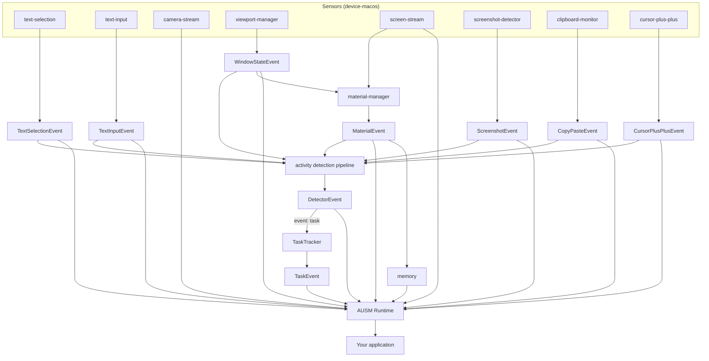

# AUSM reference

The full technical reference: architecture, runtime API, events, detectors, memory, Electron, setup and publishing. For the overview, see the [README](../README.md).

## Architecture and data flow



- **viewport-manager** — window appear/focus/unfocus/vanish/title/bounds (`WindowStateEvent`) and Mission Control space (`SpaceChangeEvent`). Darwin default.
- **text-selection** — AX selection (node-gyp). Darwin default.
- **text-input** — AX focus/typing/blur. Opt-in (`textInput.enableNativeTextInput`).
- **screenshot-detector** — system screenshot start/update/finish. Darwin default.
- **clipboard-monitor** — copy/paste. Darwin default.
- **cursor-plus-plus** — clicks/scrolls/holds + cursor crop. Opt-in (`cursorPlusPlus.enabled`).
- **screen-stream** — ScreenCaptureKit frames (SHM). Not an event source; feeds material-manager and the focused JPEG. Opt-in (`enableScreenStreaming`). 
- **camera-stream** — AVFoundation webcam frames (SHM `/ausm-camera-frames`). Not an event source and not on the material / detector path. Host polls `getCameraDevices()` / `captureLatestCameraFrame()`. Opt-in (`enableCameraStreaming`); needs Camera permission. 

`WindowStateEvent` plus screen frames go to `material-manager` (crop + tiled pHash) → `MaterialEvent` → memory. The host pulls stored materials, frames, OCR, screenshots, and weights via `runtime.getMaterials()` / `getMaterialFrames()` / `getMaterialContent()` / `getScreenshots()` / `getMaterialWeights()` (Electron preload does not expose these; main-process only). The same activity events plus the focused-material JPEG go to Vertex or Cerebras → `DetectorEvent`; `event: task` is mapped by `TaskTracker` → `TaskEvent`. Both `DetectorEvent` and `TaskEvent` are subscribed on the runtime and forwarded to Electron (`ausm:detectorEvent`, `ausm:taskEvent`).

---

`initialize()` order: screen → camera → sensors → memory → HTTP host (if `http.enabled` or `materialChat.enabled`) → materials → cursor++ → load `detectors/` → pipeline (skips first 2500 ms of viewport census). Pipeline needs a configured model (Vertex `projectId`, `CEREBRAS_API_KEY`, or an `apiBaseUrl`); missing optionals warn and continue, except Material Chat, whose start failure rejects `initialize()`.

## Map

| Package / path | Role |
|---|---|
| `ausm` → `packages/ausm` | Public install: re-exports core + bridge + material-chat |
| `@ausm/core` → `packages/core/src/index.ts` | Event types + factories |
| `ausm/runtime` → `packages/core/src/runtime/index.ts` | `createRuntime()`, `AUSMRuntime`, `AUSMRuntimeConfig` |
| `ausm/clients` → `packages/core/src/runtime/clients/` | Native / process bridges |
| `ausm/bridge` → `packages/bridge` | Electron IPC (`/electron`, `/preload`, `/preload-api`) |
| `@ausm/detector-pipeline` → `packages/detector-pipeline` | In-process evaluator (`vertex-client.ts`, `cerebras-client.ts`) |
| `@ausm/material-chat` → `material-chat` | Memory search + Claude agent service (`material-chat` bin) |
| `packages/core/src/events/` | One file per `AUSMEventKind` |
| `packages/core/src/detectors/` | `DETECTOR.md` loader + `TaskTracker` |
| `packages/core/src/memory/` | SQLite store; child `memory-service` |
| `packages/core/detectors/rapid-task/DETECTOR.md` | Shipped task classifier (`event: task`) |
| `device-macos/<service>/` | Sensor: TS wrapper + Swift helper (text-selection is node-gyp) |
| `device-macos/internal-lib/screen-stream-reader` | Python SHM client (also shipped inside `@ausm/device-macos-screen-stream`) |

## Usage

The AUSM package can be used in the following way.

```typescript
import { createRuntime, type AUSMRuntimeConfig } from 'ausm/runtime';
import type { MaterialEvent, TaskEvent } from 'ausm';

const runtime = createRuntime({
  enableScreenStreaming: true,
  textInput: { enableNativeTextInput: true },
  materialManager: { enabled: true, dbPath: '/path/to/ausm.db' },
  cursorPlusPlus: { enabled: true },
  detectorPipeline: { provider: 'cerebras' }, // or 'vertex' + projectId
  materialChat: { enabled: true }, // optional; or http: { enabled: true, port: 8788 }
  logging: { eventFrequency: true },
});
await runtime.initialize();
runtime.onMaterialEvent((e) => { /* ... */ });
runtime.onTaskEvent((e) => { /* ... */ });
runtime.shutdown();
```

Prefer `createRuntime()`. `ausmRuntime` is a singleton (selection on). Full config: `AUSMRuntimeConfig`.

**On by default (darwin):** text-selection, screenshot, clipboard, viewport, detector scan. **Off unless set:** screen stream, camera, text-input, material-manager, cursor++, memory OCR, Material Chat HTTP host. Pipeline runs if Vertex `projectId` or `CEREBRAS_API_KEY` is set (`TASK_DETECTOR_PROVIDER` or auto: Cerebras when only an API key is present). Memory DB is `materialManager.dbPath` (default `:memory:`). Material Chat is a child process on `127.0.0.1:8788` (`http.port`); set `materialChat.dataDir` for session/prefs and a real `materialManager.dbPath`. It answers only requests without an `Origin` or from localhost / `file://` pages; add other renderer origins with `materialChat.allowedOrigins`. Do not start the `material-chat` bin by hand on the product path.

| Subscribe | Event |
|---|---|
| `onTextSelectionEvent` | `TextSelectionEvent` |
| `onApplicationSwitchEvent` | `WindowStateEvent` (all window states) |
| `onSpaceChangeEvent` | `SpaceChangeEvent` |
| `subscribeToTextInputEvent` | `TextInputEvent` (not `onTextInputEvent`) |
| `onScreenshotEvent` | `ScreenshotEvent` |
| `onCopyPasteEvent` | `CopyPasteEvent` |
| `onCursorPlusPlusEvent` | `CursorPlusPlusEvent` |
| `onMaterialEvent` | `MaterialEvent` (`onMaterialFrameEvent` deprecated) |
| `onDetectorEvent` | `DetectorEvent` |
| `onTaskEvent` | `TaskEvent` (`event: task` / `rapid-task` only) |

Callbacks are additive; each `on*` returns an unsubscribe function, and `shutdown()` does not clear them. Matching `emit*Event` methods exist for tests.

Queries after init: `getScreenDisplays`, `captureLatestScreenFrame`, `getCameraDevices`, `captureLatestCameraFrame`, `getMaterials`, `getMaterialLatestFrame` / `Frames` / `Content` / `Weights`, `getScreenshots` / `getScreenshot`, `freezeMemory` / `unfreezeMemory`. Stubs (empty): `getImmediateContext`, `getRelevantMaterials`, `getScreenshotImageData`, `getCoveredMaterials`, `getBounds`, `getActiveMaterialWindows`.

## Events

`AUSMEvent`: `kind`, `eventID`, `timestamp`, `displayID`. Types in `packages/core/src/events/`. `kind` is the discriminant; payload enums are `UPPER_SNAKE`. Pipeline wire names are hyphenated (`window-state`).

| `kind` | File | Notes |
|---|---|---|
| `textSelection` | `TextSelectionEvent.ts` | `SelectionMethod`, `SelectionStage` |
| `textInput` | `TextInputEvent.ts` | `STARTED` / `UPDATED` / `ENDED` |
| `screenshot` | `ScreenShotEvent.ts` | image on `SCREENSHOT_FINISHED` only |
| `windowState` | `WindowStateEvent.ts` | `APPEAR` `FOCUSED` `UNFOCUSED` `VANISHED` `TITLE_CHANGED` `BOUNDS_CHANGED` |
| `copyPaste` | `CopyPasteEvent.ts` | `COPY` / `PASTE` |
| `material` | `MaterialEvent.ts` | `MATERIAL_CREATED` `MATERIAL_FOCUSED` `MATERIAL_UNFOCUSED` `FRAME_CAPTURED` `MATERIAL_CONTENT_UPDATED`; `MATERIAL_TYPE_CLASSIFIED` wired but unused |
| `cursorPlusPlus` | `CursorPlusPlusEvent.ts` | `MOVE` `CLICK` `DOUBLE_CLICK` `RIGHT_CLICK` `SCROLL` `HOLD_START` `HOLD_END` `DRAG` |
| `spaceChange` | `SpaceChangeEvent.ts` | |
| `detector` | `detectors/types.ts` | `summary`, `evidence`, `suggestedDetectors` |
| `task` | `TaskEvent.ts` | `TASK_DETECTED` / `UPDATED` / `COMPLETED` |

A `WindowTracker` is per `windowId`; a `Material` is a tab inside that window if it has persistent and different name (e.g, tabs in browser, channels in slack). `appMetadata` comes from `device-macos/material-manager/metadata-extractors.ts`. Blacklist: `materialManager.materialBlacklist`.

## Detectors

`DetectorManager` loads `detectors/` next to the `@ausm/core` package (shipped `packages/core/detectors/rapid-task`), then walks up from `__dirname`, then `detectors.extraDirs`. Each child dir needs `DETECTOR.md` (max 256 KB). Loaded once per runtime instance; create a new runtime to pick up edited detectors.

```yaml
---
name: my-detector          # required
description: one line      # required
event: my-event            # required; `task` → TaskTracker
cooldown: 10000            # ms quiet after firing
interval: 10000            # min ms between checks; default = cooldown
debounce: 5000             # max ms from new activity to a check; default interval/2
trigger: interval          # `screen` is parsed but not scheduled yet
enabled: true
sources: [screen, events]
events: [material, window-state, text-input, text-selection, copy-paste, cursor, screenshot]
isolated: false            # own model call
dispatchOnly: false        # only if another detector suggests it
---
Natural-language spec (model body).
```

YAML comments (`# …`) are ignored. `detectors.entries.<name>.enabled: false` disables a detector from config (it can't force-enable one whose file says `false`); `detectors.enabled: false` turns detectors off.

`rapid-task` is `isolated`, always classifies. `TaskTracker` maps `begin|continue|update|end|switch` onto one current task id.

Pipeline: focused-material JPEG + compact events → `VertexDetectorClient` or `CerebrasDetectorClient`. Wire types: `text-input`, `window-state`, `text-selection`, `material`, `cursor`, `copy-paste`, `screenshot`. Shared prompt/schema: `packages/detector-pipeline/prompts.ts`.

| Provider | Auth | Default model | Client |
|---|---|---|---|
| `vertex` | ADC (`gcloud auth application-default login`) + `TASK_DETECTOR_PROJECT_ID` | `gemini-2.0-flash` | `vertex-client.ts` |
| `cerebras` | `CEREBRAS_API_KEY` (OpenAI-compatible, `https://api.cerebras.ai/v1`) | `gemma-4-31b` | `cerebras-client.ts` |
| `cerebras` + `apiBaseUrl` | any OpenAI-compatible server, e.g. Ollama `http://localhost:11434/v1`; key optional for a non-Cerebras URL | set `model` | `cerebras-client.ts` |

The model must accept `image_url` parts (the focused frame, JPEG, longest side 768 px) and `response_format: json_object`. A text-only model fails every evaluation.

## Memory

Child process `dist/memory-service.js`. SQLite WAL + `sqlite-vec`; embeddings `Xenova/all-MiniLM-L6-v2` (384-d). Schema in `memory-store.ts`: materials, frames, screenshots, tasks, focus sessions, OCR, embeddings. `persons` tables exist; no runtime API yet.

`memory.ocrEnabled` → Apple Vision on `MATERIAL_UNFOCUSED` (`pip install -r packages/core/src/memory/py/requirements.txt`). Emits `MATERIAL_CONTENT_UPDATED`; full text via `getMaterialContent`. `memory.frozen` drops writes.

## Electron

Import `ausm/bridge/electron` **before** `app.ready` (`ausm-screenshot://`).

```typescript
import { setupAUSMElectronBridge, getAUSMPreloadPath } from 'ausm/bridge/electron';
const win = new BrowserWindow({ webPreferences: { preload: getAUSMPreloadPath(), contextIsolation: true } });
const bridge = setupAUSMElectronBridge(win, runtime);
```

Default preload = `window.ausm` only. Host extras: `exposeAUSM()` from `/preload-api`. Channels: `AUSM_IPC_CHANNELS` in `electron-bridge.ts`.

`npm run services:*` is screen-stream + visualizer only. Product path is `createRuntime()` + `initialize()`.

## Setup

macOS 13+, Xcode CLI Tools, Node ≥ 18, Swift ≥ 5.9, Python ≥ 3.9.

Permissions (Terminal **and** Electron.app): Screen Recording, Accessibility, Camera (if streaming).

```bash
npm install
npm run build            # phase1 services+base → phase2 runtime/clients → phase3 bridge
python3 -m venv .venv && source .venv/bin/activate
pip install -e device-macos/internal-lib/screen-stream-reader
pip install -r device-macos/material-manager/py/requirements.txt
pip install -e device-macos/screen-visualizer
cp .env.example .env     # optional
```

| Env | Default | |
|---|---|---|
| `SIGN_IDENTITY` | `-` (ad-hoc) | codesign helpers |
| `TASK_DETECTOR_PROVIDER` | `vertex` (or `cerebras` if only `CEREBRAS_API_KEY` is set) | `vertex` \| `cerebras` |
| `TASK_DETECTOR_PROJECT_ID` | — | Vertex; or `AUSM_DETECTOR_PROJECT_ID` |
| `TASK_DETECTOR_LOCATION` | `global` | Vertex region |
| `CEREBRAS_API_KEY` | — | Cerebras; optional for a local `CEREBRAS_BASE_URL` |
| `CEREBRAS_BASE_URL` | `https://api.cerebras.ai/v1` | any OpenAI-compatible server |
| `TASK_DETECTOR_MODEL` | `gemini-2.0-flash` / `gemma-4-31b` | per provider |

```bash
npm run build            # phase1 services+base → phase2 runtime/clients → phase3 bridge
npm run typecheck && npm run clean
```

`TSUP_PHASE=base|runtime` in `packages/core/tsup.config.ts`. Rebuild Swift: `device-macos/<name>` `build:swift` (screen/camera: `build:helper`). Device TS: `npm run build` in that package. Pipeline: build it, then `build:phase2`. Native selection: `npm run rebuild` in text-selection. Node switch: `npm rebuild better-sqlite3`.

| Symptom | Fix |
|---|---|
| `better_sqlite3.node` / MM unavailable | `npm rebuild better-sqlite3`; Electron: `materialManager.nodePath` |
| No frames | Screen Recording on the **host binary**; codesign helper |
| No AX events | Accessibility; restart host |
| No `TaskEvent` | Vertex project + ADC, `CEREBRAS_API_KEY`, or a local `apiBaseUrl` with a vision model; materials + screen stream on |
| Setup but no cursor/screenshot/clipboard | `npm run build` |

## Change map

| Task | Where |
|---|---|
| New event kind | `AUSM.ts` + `events/XEvent.ts` + `index.ts` + runtime subscribe/emit + bridge + preload-api |
| New detector | `packages/core/detectors/<name>/DETECTOR.md` |
| Frontmatter / load | `detectors/DetectorManager.ts` |
| Task continuity | `detectors/TaskTracker.ts` |
| Model prompt | `detector-pipeline/prompts.ts` |
| Vertex / Cerebras clients | `vertex-client.ts`, `cerebras-client.ts` |
| What is sent to the model | `AUSMRuntime.startDetectorPipeline()` |
| Material identity | `device-macos/material-manager/window-tracker.ts` |
| pHash / crop | `material-manager/py/` + `frame-reader.ts` |
| Browser/IDE metadata | `metadata-extractors.ts` |
| SQLite / IPC | `memory/memory-store.ts`, `memory/service.ts`, `clients/memory-client.ts` |
| Runtime wiring | `packages/core/src/runtime/index.ts` only |


## Publish (npm)

Hosts install the unscoped `ausm` package. Internals stay under `@ausm/*`. The monorepo root stays private. After `npm run build`:

1. Create the `@ausm` org on npm (for the scoped internals) and `npm login`.
2. `npm run pack:check` and confirm each tarball includes `dist`, Swift helpers under `build/`, `detectors/` (core), and `python/screen-stream-reader` (screen-stream).
3. First publish in dependency order (circular: a few device packages depend on `@ausm/core`, which optionally depends on them):
   - sensors with no `@ausm/core` dep: text-selection, screen-stream, viewport, text-input, cursor-plus-plus, camera, detector-pipeline
   - `@ausm/core`
   - material-manager, screenshot-detector, clipboard-monitor
   - `@ausm/bridge`, `@ausm/material-chat`
   - `ausm` (the public umbrella — publish last)
4. From each package directory: `npm publish --access public` (unscoped `ausm`: `npm publish -w ausm`).

Host install:

```bash
npm install ausm
```

macOS helpers ship as prebuilt binaries in each device package. Text-selection compiles on install unless `prebuilds/` were generated (`npm run build:prebuilds` in that package before publish). Frame crop needs Python with `pip install -r device-macos/material-manager/py/requirements.txt` (numpy, opencv-python-headless, pyobjc Vision/Quartz; shipped in `@ausm/device-macos-material-manager`), and OCR also `packages/core/src/memory/py/requirements.txt`.

## License

MIT
